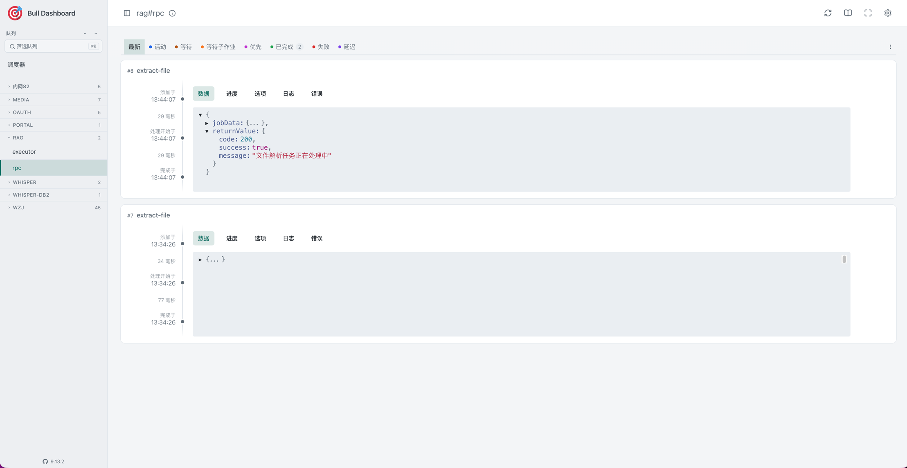

# bullboard-nestjs

基于 bull-board 的队列管理面板，支持 BullMQ 和旧 Bull，用于在测试环境中快速查看和操作队列。

## 界面预览



## 本项目的扩展

以下是本项目在 [bull-board 9.13.2](https://github.com/felixmosh/bull-board/tree/v9.13.2) 基础上增加的功能。

- **手动刷新当前视图**。在总览、队列和任务详情页都可以点击顶部按钮刷新数据。在任务详情页，已打开的日志也会一起刷新，当前详情标签页会保留。
- **记住队列筛选词**。浏览器会保留上次输入的队列搜索词，重新打开面板后仍可沿用。
- **在同一个面板查看多个 Redis 实例**。在 `env/bullmq.config.json` 中为每组队列分别配置 Redis 地址、数据库、键前缀和证书。每组可指定队列，也可设置为启动时自动发现 BullMQ 队列。
- **按配置组织队列分组**。用 `prefix` 给不同环境或应用加上展示前缀。队列按 `#` 分组，名称里的 `-` 保持原样。
- **BullMQ Redis 连接探活**。同组队列共用一个 Redis 连接。面板每 30 秒检查一次连接，探活失败时会记录日志。
- **使用密码摘要配置面板登录**。部署时在 `env/.env` 中填写账号和密码的 SHA-256 摘要，浏览器登录时输入原始密码。

## 镜像地址

Docker Hub：<https://hub.docker.com/r/jyxiaoqinvar/bullboard/tags>

下文使用 `latest` 镜像标签。

## 配置文件

以下以 `~/bullboard` 为部署目录：

```shell
mkdir -p ~/bullboard/env ~/bullboard/logs
cd ~/bullboard
```

创建 `env/.env`：

```dotenv
# NestJS 端口
PORT=9110

# 面板认证账号
BULL_BOARD_USERNAME=root
# SHA-256 摘要内容（以下对应 1234567890 的 SHA-256 摘要）
BULL_BOARD_PASSWORD_HASH=c775e7b757ede630cd0aa1113bd102661ab38829ca52a6422ab782862f268646
```

创建 `env/bullmq.config.json`。文件必须使用标准 JSON，不支持注释或尾逗号：

```json
[
  {
    "host": "<redis-host>",
    "port": 6379,
    "username": "",
    "password": "<redis-password>",
    "ca": "",
    "clientCert": "",
    "clientKey": "",
    "dbNum": 0,
    "bullPrefix": "bull",
    "timeout": 10000,
    "prefix": "app#",
    "queueType": "bullmq",
    "queues": ["example-queue"]
  }
]
```

将 `<redis-host>`、`<redis-password>` 和 `example-queue` 替换为实际连接信息和队列名。`host` 应填写容器能访问的 Redis 地址。容器内的 `127.0.0.1` 指向容器自身。

| 字段 | 说明 |
| --- | --- |
| `host`、`port` | Redis 主机地址和端口。 |
| `username` | 可选。默认用户或未启用 ACL 时可留空。 |
| `password` | Redis 密码，无密码时填空字符串。 |
| `ca` | 可选。Redis TLS CA 证书路径，例如 `./env/ca.cer`。 |
| `clientCert`、`clientKey` | 可选。双向 TLS 的客户端证书和私钥路径，例如 `./env/client.cer`、`./env/client.key`，必须同时填写或同时留空。 |
| `dbNum` | Redis 数据库编号。 |
| `bullPrefix` | 必填。队列在 Redis 中使用的键前缀，须与生产者配置一致。 |
| `timeout` | 可选。Redis 连接超时时间，单位毫秒，默认 `10000`。 |
| `prefix` | 可选。面板中的展示前缀，与 Redis 键前缀无关。面板按 `#` 拆分目录，队列名中的 `-` 不会拆分目录。 |
| `queueType` | 可选。`bullmq`（默认）或 `bull`。旧 Bull 必须设置为 `bull`。 |
| `queues` | 必填。要展示的队列名数组。BullMQ 可填 `[]`，旧 Bull 必须列出队列名。 |

未启用 TLS 时，将三个证书字段留空或省略。填写任一证书路径会启用 TLS；相对路径以应用工作目录为基准，Docker 中为 `/app`，部署目录下的 `env` 挂载到 `/app/env`。

BullMQ 的 `queues` 为 `[]` 时，应用在启动时扫描指定 Redis 数据库内、`bullPrefix` 下的 `meta` 键来发现队列。运行期间新增的队列需要重启应用后才会显示。

## 部署

### Docker Compose

将仓库里的 [docker-compose.yaml](docker-compose.yaml) 放到部署目录，与 `env/` 和 `logs/` 同级。模板使用 `jyxiaoqinvar/bullboard:latest`，将这两个目录分别挂载到容器的 `/app/env` 和 `/app/logs`。

模板还挂载了宿主机的 `/etc/localtime` 和 `/etc/vimrc`。部署机器缺少对应文件时，删除模板中的对应挂载项即可。

在部署目录启动面板：

```shell
docker compose up -d bullboard
```

### Docker

```shell
docker run -d \
  --name bullboard \
  -p 9110:9110 \
  -e TZ=Asia/Shanghai \
  -e LANG=zh_CN.UTF-8 \
  -v "$PWD/env:/app/env" \
  -v "$PWD/logs:/app/logs" \
  --restart unless-stopped \
  jyxiaoqinvar/bullboard:latest
```

### 访问面板

部署完成后访问 `http://<服务器 IP>:9110`，使用配置的账号和原始密码登录。部署时请替换示例账号和密码摘要。修改 `env/.env` 中的 `PORT` 时，也要调整端口映射右侧的容器端口。浏览器访问端口由映射左侧的宿主机端口决定。
