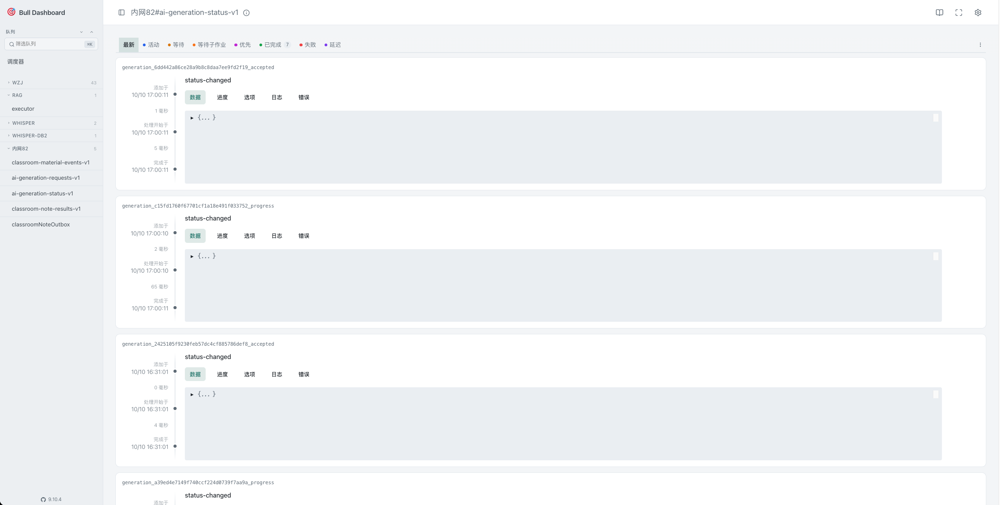

# bullboard-nestjs

基于 bull-board 的队列管理面板，支持 BullMQ 和旧 Bull，用于在测试环境中快速查看和操作队列。

## 界面预览



## 镜像地址

Docker Hub：<https://hub.docker.com/r/jyxiaoqinvar/bullboard/tags>

下文使用 `latest` 镜像标签。

## 配置文件

以下以 `~/bullboard` 为部署目录：

```shell
mkdir -p ~/bullboard/env ~/bullboard/logs
cd ~/bullboard
```

创建 `env/.env`：

```dotenv
# NestJS 端口
PORT=9110

# 面板认证账号
BULL_BOARD_USERNAME=root
# SHA-256 摘要内容（以下对应 1234567890 的 SHA-256 摘要）
BULL_BOARD_PASSWORD_HASH=c775e7b757ede630cd0aa1113bd102661ab38829ca52a6422ab782862f268646
```

创建 `env/bullmq.config.json`。文件必须使用标准 JSON，不支持注释或尾逗号：

```json
[
  {
    "host": "<redis-host>",
    "port": 6379,
    "username": "",
    "password": "<redis-password>",
    "ca": "",
    "clientCert": "",
    "clientKey": "",
    "dbNum": 0,
    "bullPrefix": "bull",
    "timeout": 10000,
    "prefix": "app#",
    "queueType": "bullmq",
    "queues": ["example-queue"]
  }
]
```

将 `<redis-host>`、`<redis-password>` 和 `example-queue` 替换为实际连接信息和队列名。`host` 应填写容器可访问的 Redis 地址；上述 Docker 部署方式中的 `127.0.0.1` 指向容器自身。

| 字段 | 说明 |
| --- | --- |
| `host`、`port` | Redis 主机地址和端口。 |
| `username` | 可选。默认用户或未启用 ACL 时可留空。 |
| `password` | Redis 密码，无密码时填空字符串。 |
| `ca` | 可选。Redis TLS CA 证书路径，例如 `./env/ca.cer`。 |
| `clientCert`、`clientKey` | 可选。双向 TLS 的客户端证书和私钥路径，例如 `./env/client.cer`、`./env/client.key`，必须同时填写或同时留空。 |
| `dbNum` | Redis 数据库编号。 |
| `bullPrefix` | 必填。队列在 Redis 中使用的键前缀，须与生产者配置一致。 |
| `timeout` | 可选。Redis 连接超时时间，单位毫秒，默认 `10000`。 |
| `prefix` | 可选。面板中的展示前缀，与 Redis 键前缀无关。面板按 `#` 拆分目录，队列名中的 `-` 不会拆分目录。 |
| `queueType` | 可选。`bullmq`（默认）或 `bull`。旧 Bull 必须设置为 `bull`。 |
| `queues` | 必填。要展示的队列名数组。BullMQ 可填 `[]`，旧 Bull 必须列出队列名。 |

未启用 TLS 时，将三个证书字段留空或省略。填写任一证书路径会启用 TLS；相对路径以应用工作目录为基准，Docker 中为 `/app`，部署目录下的 `env` 挂载到 `/app/env`。

BullMQ 的 `queues` 为 `[]` 时，应用在启动时扫描指定 Redis 数据库内、`bullPrefix` 下的 `meta` 键来发现队列。运行期间新增的队列需要重启应用后才会显示。

## 使用 Docker 部署

```shell
docker run -d \
  --name bullboard \
  -p 9110:9110 \
  -e TZ=Asia/Shanghai \
  -e LANG=zh_CN.UTF-8 \
  -v "$PWD/env:/app/env" \
  -v "$PWD/logs:/app/logs" \
  --restart unless-stopped \
  jyxiaoqinvar/bullboard:latest
```

常见操作：

```shell
# 查看日志
docker logs -f bullboard

# 停止容器
docker stop bullboard

# 启动容器
docker start bullboard

# 删除容器
docker rm -f bullboard
```

## 使用 Docker Compose 部署

创建 `docker-compose.yaml`：

```yaml
services:
  bullboard:
    image: jyxiaoqinvar/bullboard:latest
    container_name: bullboard
    ports:
      - "9110:9110"
    environment:
      TZ: "Asia/Shanghai"
      LANG: "zh_CN.UTF-8"
    volumes:
      - ./env:/app/env
      - ./logs:/app/logs
      # （可选）覆盖镜像内置 PM2 配置；不挂载时使用镜像自带的 /app/pm2.config.cjs
      # - ./pm2.config.cjs:/app/pm2.config.cjs:ro
    restart: unless-stopped
```

镜像默认使用内置的 `/app/pm2.config.cjs`。需要自定义 PM2 运行参数时，将本仓库根目录的 `pm2.config.cjs` 复制到部署目录，并取消上方挂载注释。修改前请确认各配置项的含义，参考 PM2 配置文档：<https://pm2.keymetrics.io/docs/usage/application-declaration/>。

部署完成后访问 `http://<服务器 IP>:9110`，使用配置的账号和原始密码登录，而不是填写密码摘要。示例账号为 `root`，密码为 `1234567890`，部署时请替换为自己的账号和密码摘要。
